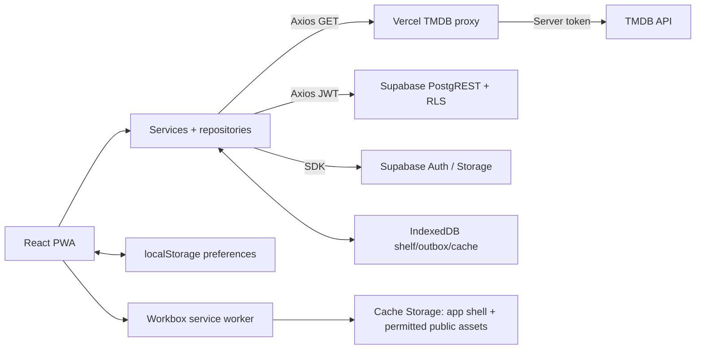

# Architecture and Engineering Specification

## 1. Stack
React + Vite (JavaScript JSX, ES modules); Tailwind via Vite integration, CSS design tokens, Lucide; React Router HashRouter; Axios; Supabase JS SDK for auth/storage and Axios PostgREST for data; IndexedDB via Dexie (or native if equivalent), localStorage for simple preferences/draft metadata; vite-plugin-pwa generateSW/Workbox; Vercel SPA and one Node serverless function; Vitest + React Testing Library, ESLint; Playwright optional. Use compatible stable packages and lockfile; do not pin speculative versions. Use React hooks and explicit domain state rather than Redux. TanStack Query optional only if it simplifies public queries; not the offline write store.

## 2. System diagram

TMDB and Supabase data are independent; merge in app (not in PostgreSQL). Public source requests fail independently. Private data never cached in SW. Auth session is SDK-managed, not application-generated UUID auth.

## 3. Proposed tree
```
cinetrack/
  AGENTS.md README.md CODEX_PROMPT.md docs/
  package.json package-lock.json vite.config.js index.html .env.example .gitignore
  api/tmdb.js                    # Vercel HTTP adapter
  server/tmdbProxy.js             # shared validation/upstream transport
  public/icons/                   # PNG manifest icons + original SVG
  public/images/                  # placeholders, approved TMDB logo
  src/
    main.jsx App.jsx
    styles/{globals.css,tokens.css}
    config/{env.js,genres.js,author.js}
    router/routes.jsx
    components/{layout,common,movie,shelf,forms,pwa}/
    pages/{HomePage,ExplorePage,MovieDetailPage,ShelfPage,MovieFormPage,ProfilePage,ContributionsPage,NotFoundPage}.jsx
    domain/{movie.js,shelf.js,validation.js,merge.js}
    services/{tmdbService.js,postgrestClient.js,customMovieService.js,authService.js,storageService.js,shelfService.js}
    repositories/{catalogRepository.js,shelfRepository.js,draftRepository.js}
    db/{localDb.js,syncEngine.js}
    hooks/{useCatalog.js,useMovieDetail.js,useShelf.js,useNetwork.js,useInstall.js}
    contexts/{AuthContext.jsx,ShelfContext.jsx,ToastContext.jsx}
    tests/
  supabase/migrations/0001_init.sql
```
Names may vary if documented. Keep server-only code outside src; never import it into client bundle. Vite dev middleware reuses `server/tmdbProxy.js` with env loaded server-side; preview integration via `vercel dev` or deployed HTTPS. Production build `npm run build` does not need server token to compile; live proxy requires it.

## 4. Shared domain contract (JSDoc)
```js
/** @typedef {'tmdb'|'custom'} MovieSource */
/** @typedef {{key:string, source:MovieSource, sourceId:string,
 * title:string, year:number|null, synopsis:string, genreIds:number[],
 * posterUrl:string|null, backdropUrl:string|null, tmdbRating:number|null,
 * voteCount:number|null, runtime:number|null, director:string|null,
 * cast:string[], trailerUrl:string|null, ownerId:string|null,
 * deleted:boolean}} Movie */
/** @typedef {'planned'|'watching'|'completed'|'dropped'} ShelfStatus */
/** @typedef {{id:string,userId:string,movieKey:string,source:MovieSource,
 * tmdbId:number|null,customMovieId:string|null,snapshot:object|null,
 * status:ShelfStatus,personalRating:number|null,review:string,
 * completedAt:string|null,createdAt:string,updatedAt:string,
 * syncState:'synced'|'pending'|'error'}} ShelfItem */
```
- TMDB `sourceId = String(id)`; custom UUID. `key` canonical. Route validates source+id; build path with encodeURIComponent. Missing fields null/empty, not fake zeros. TMDB rating null if vote_count 0; custom rating null. ISO dates UTC; year derived from release_date. Normalize TMDB genre_ids vs detail genres; use `https://image.tmdb.org/t/p/w342` or configured image size/base when permitted. Cast/director from credits. Trailer optional official video key only.
- Snapshot custom: title/year/genre/poster path only as needed; store normalized safe object. TMDB: source ID plus permitted fields after terms check. Do not permanently mirror whole responses. If permission not confirmed, ID-only database snapshot; locally cache only permitted data, fallback title label `TMDB movie #<id>` and placeholder when offline. Shelf CRUD never depends on cache.
- `syncState` local only, not DB column. DB snake_case mapped centrally to camelCase. Never let UI call raw Axios or storage directly.

## 5. Catalog merge/pagination
`catalogRepository.query({query,genreId,source,sort,cursors})` returns `{items,next:{tmdb,custom},errors,stale}`. Both branches parallel `Promise.allSettled`, abort superseded search via AbortController/request sequence. TMDB page starts 1; custom offset/limit 20 ordered by created_at desc,id desc (offset can drift on live edits, dedupe). All mode combines page results with stable order (alternate or TMDB then custom, documented; no claim globally sorted/popular); custom newest row independent. Use separate source cursors, append only successful page and update cursor only on success. Reset on filter/search. Source-specific sort if supported; do not present client-only sort as global across unloaded pages. Search title using TMDB search endpoint and escaped PostgREST ilike. TMDB search doesn't accept genre filter; post-filter loaded results and explain that more pages may contain matches; no search uses discover genre. Custom genres filter using array containment. Duplicate by canonical key; cross-source title/year matches are warnings, not automatically merged into same identity. Home requests max 2–3 TMDB sections in parallel + community recent (limit 10); trending hero from first eligible backdrop.

## 6. Auth lifecycle
- Read SDK session on mount; call signInAnonymously only if no stored session and online, single-flight (StrictMode-safe). If failure show public browsing + retry, disable cloud writes until session. Never replace an expired/invalid cached account automatically if pending data belongs to it. Refresh via SDK when online. JWT access token attached to Axios requests at request time; 401 refresh once, no infinite loop.
- Store last-known user ID only to partition local data; do not treat as credential. Offline with previously initialized guest: allow local shelf edits under that namespace. Without identity: read public cache, prompt to connect to initialize. Never replay old queue under new UID. Session loss: show recoverable error/export local data option P1; do not delete pending records. Account storage clear loses identity and queue; explain in Profile.
- Public read custom catalog may use publishable key without JWT; anonymous auth role is authenticated and should follow owner RLS. Do not persist user tokens in logs or custom caches. SDK session storage remains browser-local as intended.

## 7. Online custom flow
1. Validate and duplicate check; generate client UUID once; upload permitted file if provided using `<uid>/<movieId>/<randomUUID>.<ext>` to public poster bucket. Keep existing poster until row confirmed. No write if no valid JWT.
2. Insert/patch real row with owner bound by RLS. If ambiguous network failure, query row by stable UUID before retry; never blindly create a second record. On failure, preserve draft, attempt cleanup of newly uploaded object only if confirmed not referenced. On success invalidate list/detail caches, refresh community and contributions, navigate detail.
3. Soft delete owner row `deleted_at` (see DB) preserves shelf reference. Do not remove poster immediately if used by existing shelf snapshot; retention/cleanup manual in MVP. No destructive cascade affecting other user's shelf. A removed film cannot be newly added by UI; existing shelves remain editable.

## 8. Data and error policy
Request timeout ~10–12s; limited retry GET only, exponential backoff with jitter, honor Retry-After on 429; mutations use outbox/idempotent UUID and no blind retry on unknown outcomes. Error envelope `{code,message,retryable,status}`; offline distinct from HTTP 401/403/429/5xx. Show partial results. Store validated inputs, no dangerous HTML. Public TMDB proxy accepts allowlisted paths/params; no arbitrary URL forwarding, no auth cookies, no token in response. Cache budget bounded. Treat user-generated poster and text as untrusted. Production demo scope limits abuse; captcha and moderation required before larger public release.
