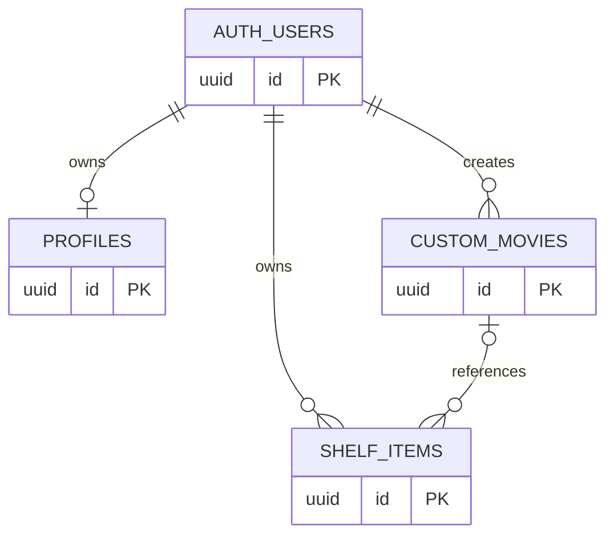

# Supabase Database & Storage Specification

## 1. Model and policy
Three tables: `profiles` (private guest preferences, separate from public assignment author config), `custom_movies` (public active catalog, owner edit), `shelf_items` (private tracking). `auth.users` is authoritative identity. TMDB is external; no table of all TMDB films. All IDs UUID except TMDB positive bigint. Use server timestamps and unique constraints. Soft delete community movie (not physical DELETE) so foreign key and prior shelf references survive. Public read active; deleted row visible only to creator. For another user's deleted movie detail, show shelf snapshot, never bypass RLS. Shelf deletion is physical, idempotent. RLS policies must be tested with real separate authenticated guest JWTs, not SQL editor service role.

## 2. ERD

TMDB reference is `tmdb_id` with no FK. Exactly one of `tmdb_id` / `custom_movie_id`; generated canonical movie_key. Unique (user_id,movie_key) blocks duplicates. Soft-delete means old shelves can be updated without FK failure.

## 3. Migration baseline (Codex to implement and test)
Use a new Supabase project. This SQL is a design baseline, not executed. Create migration with constraints and explicit policies. Current year bound fixed at 2031 for this 2026 demo; update future release deliberately (avoid volatile check). Validate genres from canonical list at app layer and enforce supported IDs here. `poster_path` and `backdrop_path` are storage object paths (not arbitrary remote URL); bucket derives public URL; store only under owner prefix. P0 poster, optional backdrop P1. Require ownership prefix on DB check.

```sql
create table public.profiles (
  id uuid primary key references auth.users(id) on delete cascade,
  display_name text check (char_length(display_name) <= 80),
  created_at timestamptz not null default now(),
  updated_at timestamptz not null default now()
);
create table public.custom_movies (
  id uuid primary key default gen_random_uuid(),
  created_by uuid not null references auth.users(id),
  title text not null check (char_length(btrim(title)) between 1 and 150),
  title_key text generated always as (lower(regexp_replace(btrim(title), '\s+', ' ', 'g'))) stored,
  release_year integer not null check (release_year between 1888 and 2031),
  synopsis text not null check (char_length(btrim(synopsis)) between 10 and 2000),
  genre_ids integer[] not null check (cardinality(genre_ids) between 1 and 19 and
    array_position(genre_ids, null) is null and genre_ids <@ array[28,12,16,35,80,99,18,10751,14,36,27,10402,9648,10749,878,10770,53,10752,37]),
  runtime integer check (runtime between 1 and 600),
  director text check (char_length(director) <= 150),
  cast_names text[] not null default '{}' check (cardinality(cast_names) <= 10),
  trailer_url text check (char_length(trailer_url) <= 500 and trailer_url ~ '^https://(www\.)?(youtube\.com|youtu\.be)/'),
  poster_path text check (poster_path is null or poster_path like created_by::text || '/' || id::text || '/%'),
  backdrop_path text check (backdrop_path is null or backdrop_path like created_by::text || '/' || id::text || '/%'),
  created_at timestamptz not null default now(),
  updated_at timestamptz not null default now(),
  deleted_at timestamptz
);
create unique index custom_movies_owner_title_year_active
  on public.custom_movies(created_by,title_key,release_year) where deleted_at is null;
create index custom_movies_recent on public.custom_movies(created_at desc,id desc) where deleted_at is null;
create index custom_movies_genres on public.custom_movies using gin(genre_ids);
create table public.shelf_items (
  id uuid primary key default gen_random_uuid(),
  user_id uuid not null references auth.users(id) on delete cascade,
  tmdb_id bigint check (tmdb_id > 0),
  custom_movie_id uuid references public.custom_movies(id) on delete restrict,
  movie_key text generated always as (
    case when tmdb_id is not null then 'tmdb:' || tmdb_id::text
    else 'custom:' || custom_movie_id::text end
  ) stored,
  snapshot jsonb check (snapshot is null or (jsonb_typeof(snapshot)='object' and octet_length(snapshot::text)<=8192)),
  status text not null default 'planned' check (status in ('planned','watching','completed','dropped')),
  personal_rating smallint check (personal_rating between 1 and 5),
  review text not null default '' check (char_length(review)<=1000),
  completed_at timestamptz,
  created_at timestamptz not null default now(),
  updated_at timestamptz not null default now(),
  check ((tmdb_id is null) <> (custom_movie_id is null)),
  check ((status='completed') = (completed_at is not null)),
  unique(user_id,movie_key)
);
create index shelf_user_updated on public.shelf_items(user_id, updated_at desc);
create or replace function public.touch_updated_at() returns trigger language plpgsql
set search_path = '' as $$ begin new.updated_at=now(); return new; end; $$;
create trigger profiles_touch before update on public.profiles for each row execute function public.touch_updated_at();
create trigger custom_movies_touch before update on public.custom_movies for each row execute function public.touch_updated_at();
create trigger shelf_items_touch before update on public.shelf_items for each row execute function public.touch_updated_at();
-- Client must not change identities or created_at; use a trigger or column grants.
-- Recommended: create guard triggers rejecting id/owner/source/created_at changes.
-- On shelf upsert use conflict on id, not generated movie_key; stable local UUID.

alter table public.profiles enable row level security;
alter table public.custom_movies enable row level security;
alter table public.shelf_items enable row level security;
create policy profile_select on public.profiles for select to authenticated using ((select auth.uid())=id);
create policy profile_insert on public.profiles for insert to authenticated with check ((select auth.uid())=id);
create policy profile_update on public.profiles for update to authenticated using ((select auth.uid())=id) with check ((select auth.uid())=id);
create policy movies_public_read on public.custom_movies for select to anon,authenticated using (deleted_at is null);
create policy movies_owner_read on public.custom_movies for select to authenticated using ((select auth.uid())=created_by);
create policy movies_owner_insert on public.custom_movies for insert to authenticated with check ((select auth.uid())=created_by and deleted_at is null);
create policy movies_owner_update on public.custom_movies for update to authenticated using ((select auth.uid())=created_by and deleted_at is null) with check ((select auth.uid())=created_by);
create policy shelf_select on public.shelf_items for select to authenticated using ((select auth.uid())=user_id);
create policy shelf_insert on public.shelf_items for insert to authenticated with check ((select auth.uid())=user_id and (custom_movie_id is null or exists (select 1 from public.custom_movies m where m.id=custom_movie_id and m.deleted_at is null)));
create policy shelf_update on public.shelf_items for update to authenticated using ((select auth.uid())=user_id) with check ((select auth.uid())=user_id);
create policy shelf_delete on public.shelf_items for delete to authenticated using ((select auth.uid())=user_id);
-- Explicit least privilege (adapt to current Supabase default grants):
revoke all on public.profiles,public.custom_movies,public.shelf_items from anon,authenticated;
grant select on public.custom_movies to anon;
grant select,insert,update on public.custom_movies,public.profiles to authenticated;
grant select,insert,update,delete on public.shelf_items to authenticated;
```
Important implementation refinements: enforce immutable IDs/owner/source/created_at with triggers; prevent restoring tombstones; validate cast names and completed_at not in future with trigger; disallow unexpected snapshot keys (private data). PostgREST upsert of existing shelf referencing deleted custom may hit INSERT policy even on conflict; sync uses PATCH for existing server rows and POST for new rows, checks id after uncertain create. For duplicate movie_key conflict, fetch owned existing row and adopt canonical ID only after confirming same user/movie; never override another user. Keep pending op if custom is removed before first sync; show conflict and allow user to discard after explicit action. Verify generated expressions supported in actual PostgreSQL and migrate on fresh database. Do not execute remote migration automatically.

## 4. Storage setup
Create bucket `movie-posters` public via dashboard or migration using supported bucket setup. Max 5 MiB, allowed MIME image/jpeg, image/png, image/webp. Public GET means anyone with URL can see image; upload UI must state this. No personal/sensitive photos. Object path `<auth.uid>/<custom_movie_uuid>/<random_uuid>.<ext>`, unique, no overwrite. Use SDK upload/remove, never direct deletion of storage metadata.

```sql
create policy poster_upload on storage.objects for insert to authenticated
with check (bucket_id='movie-posters' and (storage.foldername(name))[1]=(select auth.uid()::text));
create policy poster_owner_read on storage.objects for select to authenticated
using (bucket_id='movie-posters' and (storage.foldername(name))[1]=(select auth.uid()::text) and owner_id=(select auth.uid()::text));
create policy poster_owner_delete on storage.objects for delete to authenticated
using (bucket_id='movie-posters' and (storage.foldername(name))[1]=(select auth.uid()::text) and owner_id=(select auth.uid()::text));
```
No UPDATE policy (unique object path). Validate path and actual image MIME/size client + bucket restriction; no SVG/HTML upload. Cleanup failed newly uploaded objects only after verifying no row references them. Soft-deleted poster remains available for old shelf references; manual owner cleanup later; old images may be orphaned after edit (document maintenance). Never delete objects used by another row. Public storage is not private even though writes are protected.

## 5. Setup checklist
Enable anonymous sign-ins in Supabase dashboard; consider CAPTCHA for public exposure. Run migration once in fresh project; configure bucket; use project URL and publishable key, no service role. Test RLS with two sessions/incognito, direct requests as anon, and owner update/delete (soft). Verify SQL editor rows only for debugging. No seed required; test custom records created by demo and removed via UI.
